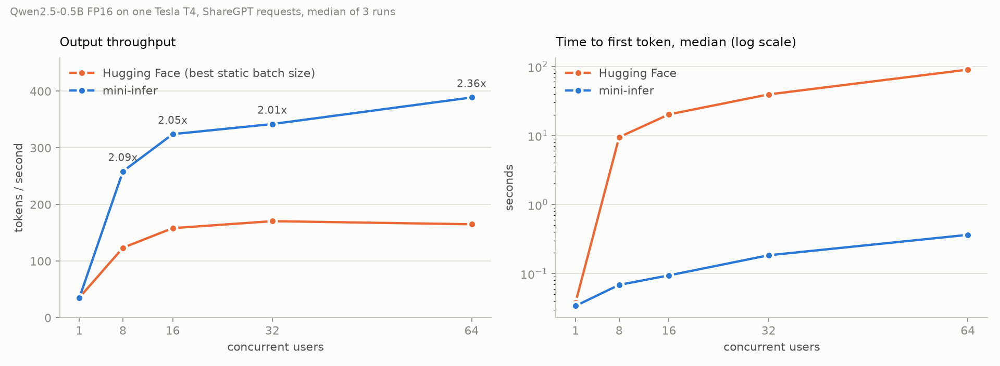
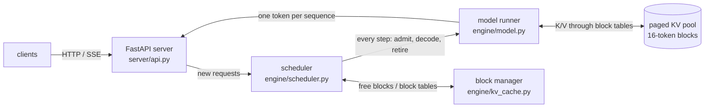
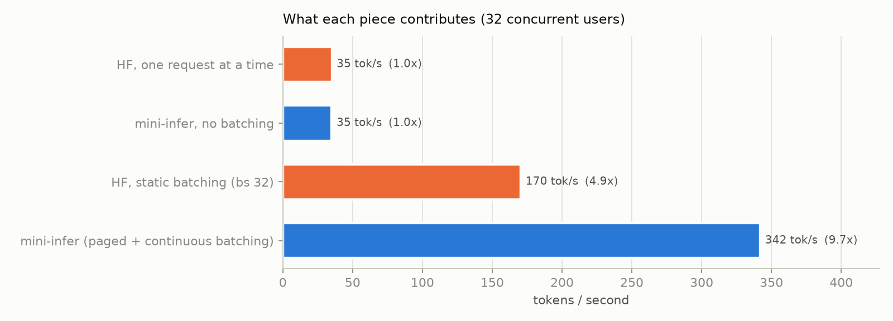
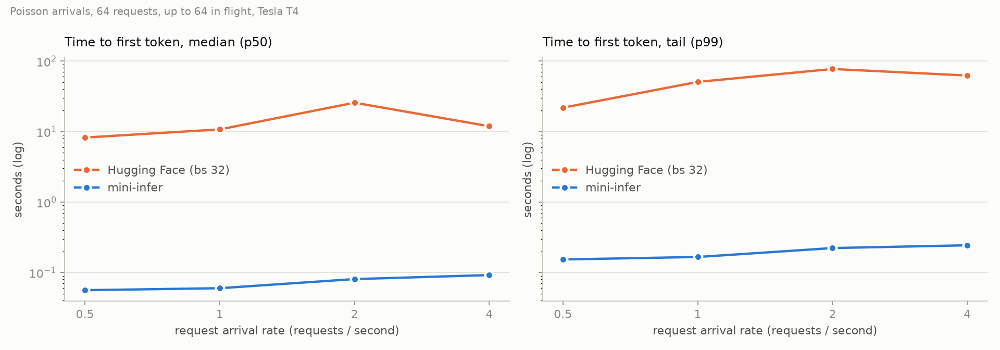

# mini-infer: an LLM inference engine from scratch

[](https://github.com/Vansh8010-boop/LLM-Inference-Engine/actions/workflows/tests.yml)

A serving engine for Qwen2.5 written from scratch in PyTorch: its own transformer
forward pass, a paged KV cache, a continuous-batching scheduler with preemption,
and a streaming OpenAI-compatible API. Measured against a Hugging Face
`model.generate()` baseline on the same GPU and the same ShareGPT traffic.

**2.0–2.4× the throughput of the best Hugging Face configuration from 8 to 64
concurrent users, and the first token arrives about 200× sooner**
(Qwen2.5-0.5B FP16, one Tesla T4, median of 3 runs).



| Concurrent users | Hugging Face (best batch size) | mini-infer | Speedup | Time to first token, p50 (HF → mini-infer) |
|---|---|---|---|---|
| 1 | 35.4 tok/s | 34.7 tok/s | 0.98× | 0.04 s → 0.03 s |
| 8 | 123.5 tok/s | 258.4 tok/s | **2.09×** | 9.5 s → 0.07 s |
| 16 | 158.2 tok/s | 324.1 tok/s | **2.05×** | 20.2 s → 0.09 s |
| 32 | 170.5 tok/s | 342.0 tok/s | **2.01×** | 39.4 s → 0.18 s |
| 64 | 165.0 tok/s | 388.9 tok/s | **2.36×** | 90.0 s → 0.36 s |

With one user there is nothing to batch and the two are level. From 8 users up,
Hugging Face's padded static batches plateau around 165–170 tok/s while the
engine keeps scaling; and because new requests join the running batch at every
step instead of waiting for a whole batch to finish, the first token comes back
in tenths of a second instead of tens of seconds.

---

## Quickstart

```bash
git clone https://github.com/Vansh8010-boop/LLM-Inference-Engine.git
cd LLM-Inference-Engine
python -m venv .venv && .venv/Scripts/activate        # Linux/macOS: source .venv/bin/activate
pip install torch --index-url https://download.pytorch.org/whl/cu128
pip install -r requirements.txt
python scripts/download_model.py                      # Qwen2.5-0.5B-Instruct into models/
```

Generate text with the engine's own forward pass:

```bash
python -m engine.generate "Explain the KV cache in one paragraph." --chat --max-tokens 128
```

Serve it (OpenAI-compatible, streaming):

```bash
python -m server.api --port 8000
curl http://127.0.0.1:8000/v1/completions -H "Content-Type: application/json" \
     -d '{"prompt": "The capital of France is", "max_tokens": 20, "temperature": 0, "stream": true}'
```

Any OpenAI client works against `http://127.0.0.1:8000/v1`.

---

## How it works



| Piece | What it does |
|---|---|
| **Forward pass** (`engine/model.py`) | Qwen2 from the safetensors weights: RMSNorm, RoPE, grouped-query attention, SwiGLU MLP. Greedy output is **bit-identical** to Hugging Face, verified on 100 prompts. |
| **Paged KV cache** (`engine/kv_cache.py`) | K/V memory split into 16-token blocks with a free list and a block table per sequence, like OS virtual memory. Attention gathers K/V through the block table. |
| **Scheduler** (`engine/scheduler.py`) | Every step: give each running sequence a slot for its next token, preempting the newest one (recompute later) if blocks run out; admit waiting requests first-come-first-served; retire finished ones and free their blocks. |
| **Engine step** (`engine/llm_engine.py`) | One forward pass for all decodes and new prefills together, flattened into one token stream. |
| **Server** (`server/api.py`) | OpenAI-compatible `/v1/completions` with server-sent-event streaming. The baseline (`server/baseline_server.py`) serves the exact same API. |
| **INT8** (`engine/quant.py`) | Weight-only, per-channel scales. |
| **Speculative decoding** (`engine/speculative.py`) | Qwen2.5-0.5B drafts k tokens, Qwen2.5-1.5B verifies them in one pass, with the rejection-sampling rule that keeps the output distribution identical. |

## Results

All final numbers come from one Tesla T4 on Kaggle (driver 580, torch 2.11,
transformers 5.20.2), the frozen workload `bench/workloads/sharegpt_1000.jsonl`,
3 warm-up requests and 3 repeated runs per configuration with the median
reported. Raw results: [`bench/results/kaggle-t4/`](bench/results/kaggle-t4/).

### What each piece contributes (32 concurrent users)



The engine without batching runs at exactly Hugging Face's sequential speed
(35.1 tok/s both), so the forward pass itself is on par. Hugging Face's static
batching gives 4.9×; paging plus continuous batching gives 9.7×.

### Latency under load



At every arrival rate the engine's **worst-case** (p99) time to first token
stays under 0.25 s; Hugging Face's ranges from 22 s to 77 s.

### KV cache and memory

| | Result |
|---|---|
| KV cache vs recomputing every step (512 tokens) | **1.66×** faster; per-token latency stays flat instead of climbing ([chart](docs/figures/kaggle-t4/kv_cache_speedup.png)) |
| KV memory wasted, reserve-max-length vs paged (ShareGPT lengths) | **80.7% → 1.9%** |
| Sequences that fit in 3 GB of KV cache | 119 → **608 (5.1×)** ([chart](docs/figures/kv_memory_waste.png)) |

### INT8 weights and speculative decoding

| | Result |
|---|---|
| INT8 weight memory | 0.99 GB → **0.63 GB (−36%)** (the tied embedding stays FP16) |
| INT8 WikiText-2 perplexity | 13.652 → **13.626** (no measurable loss) |
| INT8 speed | slower than FP16: 28.3 vs 37.0 tok/s single, 377 vs 483 tok/s batched ([chart](docs/figures/kaggle-t4/quantization_Qwen2.5-0.5B-Instruct.png)) |
| Speculative decoding, 0.5B → 1.5B, k = 2 / 4 / 6 | acceptance 68 / 54 / 44%, 2.3 / 3.1 / 3.6 tokens per target pass, but **0.90 / 0.74 / 0.62×** speed ([chart](docs/figures/kaggle-t4/speculative.png)) |

Both week-4 features are correct and measured; neither is faster on this
hardware, for the reasons below.

---

## What didn't work (and what it taught me)

1. **"Matches Hugging Face" was 93/100, not 100/100, at first.** The 7
   mismatches were all near-ties (top two logits one fp16 step apart). The cause:
   Hugging Face lets SDPA handle grouped-query attention (`enable_gqa=True`),
   which selects a different kernel than repeating the K/V heads by hand. Matching
   that made every layer bit-identical.
2. **Batched output can never be bit-identical.** A matmul over 32 rows picks
   different cuBLAS kernels than one over 1 row. The batched tests therefore
   require exact matches *except* at genuine near-ties, and check the logit gap
   at every divergence.
3. **INT8 is smaller but slower.** PyTorch's fused INT8 kernel scales linearly
   with the number of rows (70 ms vs 0.6 ms for FP16 at 1,024 rows), so the
   engine dequantizes to FP16 per call instead, and that conversion costs more
   than reading half the bytes saves. A fused Triton kernel is what would turn
   the memory saving into speed. Along the way, scaling *after* the int8 matmul
   overflowed fp16 into NaN; the weight is now scaled first.
4. **Speculative decoding needs an expensive target.** At batch size 1 both
   Qwen models are limited by CPU kernel-launch overhead, not GPU math: 24 vs 28
   layers make a 0.5B step cost about half a 1.5B step, not a tenth. It pays off
   with a much larger target (7B+) or once launch overhead is removed (CUDA graphs).
5. **The laptop ran out of memory, not the GPU.** Overlapping a model download, a
   benchmark and the tests on a 16 GB laptop exhausted Windows commit memory; a
   progress bar piped through PowerShell grew one endless line until the shell
   itself crashed. The final sweep runs one job at a time and logs to files.

## Reproduce it

```bash
python -m pytest tests -v                           # correctness: exact HF match, batching, preemption, INT8, speculative
python -m bench.make_workloads sharegpt             # frozen 1,000-request workload (already in the repo)
python -m bench.final_sweep --dry-run               # list every configuration
python -m bench.final_sweep                         # the full sweep (~3.5 h on a T4)
python -m bench.kv_cache_speedup
python -m bench.kv_memory_waste
python -m bench.quant_bench
python -m bench.speculative_bench
python -m bench.make_plots                          # rebuild every chart in docs/figures/final/
```

The Kaggle notebook that produced the final numbers is in
[`kaggle/sweep/`](kaggle/sweep/). The same comparison on an RTX 3050 Laptop
(6 GB) gave 2.37× at 32 users ([`docs/week4.md`](docs/week4.md) has the laptop
numbers for every week-4 benchmark).

## Repository layout

```
engine/      model.py, kv_cache.py, scheduler.py, llm_engine.py, sampler.py, quant.py, speculative.py, generate.py
server/      api.py (engine), baseline_server.py (Hugging Face), protocol.py (shared OpenAI API)
bench/       load_test.py, final_sweep.py, make_plots.py, workloads/, results/
tests/       exact-match vs Hugging Face, batching, scheduler, block manager, INT8, speculative decoding
kaggle/      notebook used for the final T4 sweep
docs/        figures and per-week notes
```

## License

MIT, see [LICENSE](LICENSE).
