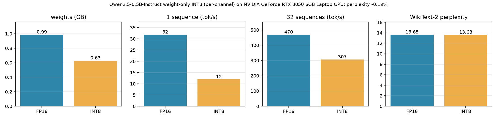
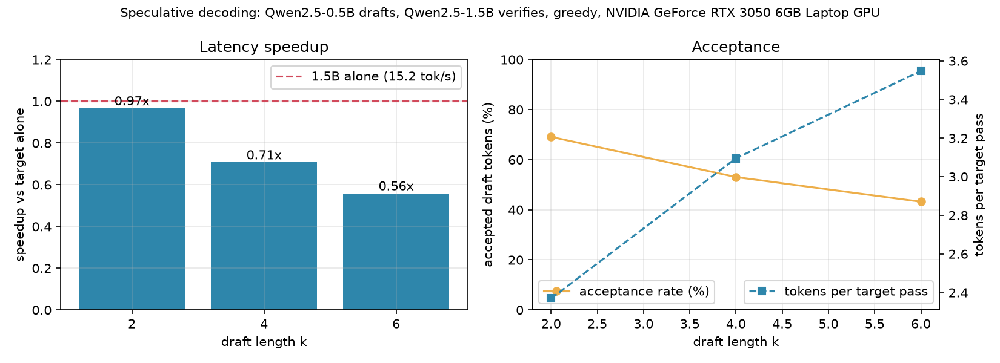

# Week 4: quantization and speculative decoding

Weeks 1–3 made the engine *serve* well: no recomputation (KV cache), no wasted
memory (paging), no idle GPU (continuous batching). Week 4 attacks the cost
of the model itself, with two independent techniques. Each one has a speed
side and a quality side, and the week is done only when both are measured.

**Done when:** both features pass their quality checks, and there is one table
of speed vs quality for every configuration.

---

## 1. INT8 weight quantization (`engine/quant.py`)

**The idea.** Every decode step reads *all* the model's weights from GPU
memory to produce one token per sequence. On a small batch that read is the
bottleneck: decoding is limited by memory bandwidth, not arithmetic. Store the
weights in 8 bits instead of 16 and there is half as much to read and to keep
in memory.

**How it works.** For each linear layer's weight matrix `W` (out × in):

1. Per output channel (each row), find the largest absolute value.
2. `scale = max_abs / 127`, then `W_int8 = round(W / scale)`: every weight becomes
   an integer in [-127, 127] plus one fp16 scale per row.
3. At run time: `y = (x @ W_int8ᵀ) * scale + bias`.

This is *weight-only* quantization: activations stay fp16, which keeps the
quality loss small. Per-channel scales matter because a single outlier row
would otherwise crush the precision of the whole matrix.

**What gets quantized.** The seven projection matrices in every layer (q, k, v,
o, gate, up, down). The embedding table stays fp16: it is shared with the
output head (`tie_word_embeddings`), and for Qwen2.5-0.5B it holds 27% of all
parameters, so the saving is smaller than "half" (≈1.0 GB → ≈0.63 GB). On
1.5B the layers dominate and the saving is larger.

**How we measure it.**

| Metric | How |
|---|---|
| Memory | bytes of weights, and peak GPU memory |
| Speed | single-sequence tokens/s, and batched engine tokens/s |
| Quality | WikiText-2 perplexity, FP16 vs INT8. Under ~2% increase is a good result |

**What to expect honestly.** Memory always drops. Speed depends on the matmul
kernel: without a fused INT8 kernel, the weight is converted back to fp16
every call, which can make INT8 *slower*. If that happens, the write-up says so
and explains why. That is a "what didn't work" entry, not a failure.

---

## 2. Speculative decoding (`engine/speculative.py`)

**The idea.** A large model is slow per token, but checking *several* tokens
costs almost the same as generating one: it is one forward pass either way,
and the pass is bound by reading the weights. So let a small, fast model guess
ahead, and let the big model check the guesses in a single pass.

- **Draft model:** Qwen2.5-0.5B (fast, weaker)
- **Target model:** Qwen2.5-1.5B (slow, the one whose output we want)
- They share a tokenizer, so their tokens are interchangeable.

**One round, with draft length k = 4:**

```
context:  "The capital of France is"
draft  →  proposes 4 tokens one by one:   " Paris" "." " It" " has"
target →  ONE forward pass over all 4, giving its own choice at each spot:
                                            " Paris" "." " It" " is"
accept →  " Paris" "." " It"   (match)     " has" ≠ " is"  →  take " is" instead
result:   4 new tokens from 1 target pass instead of 4 passes
```

If every guess matches, the target's pass also yields one bonus token, so a
round always produces between 1 and k + 1 tokens.

**Why the output is unchanged.** With greedy decoding the target only ever
keeps tokens it would have picked itself, so the text is the target's own
text, just produced faster. With sampling, a rejection-sampling rule (accept a
draft token with probability `min(1, p_target / p_draft)`, otherwise resample
from the leftover distribution) makes the output distribution *provably
identical* to the target's. That proof is one of the interview questions.

**The trade-off is k.** Larger k means more tokens per target pass when the
draft is right, but more wasted draft work when it is wrong. The acceptance
rate decides which k wins.

**How we measure it.**

| Metric | How |
|---|---|
| Acceptance rate | accepted draft tokens / proposed draft tokens |
| Tokens per target pass | average tokens gained per round |
| Speedup | latency vs the 1.5B model decoding alone, for k = 2, 4, 6 |
| Correctness | greedy output matches the 1.5B model alone |

**Memory on this laptop.** Both models together are ≈4.1 GB of fp16 weights,
which fits under the 4.8 GB cap with little room to spare. The 1.5B target
can also run in INT8, which is a natural way to combine the two features.

---

## Results (RTX 3050 Laptop 6 GB, Oct 24 2026)

### INT8 quantization, Qwen2.5-0.5B

| | Weights | 1 sequence | 32 sequences | WikiText-2 ppl | Same 32-token greedy text as FP16 |
|---|---|---|---|---|---|
| FP16 | 0.99 GB | 31.9 tok/s | 469.5 tok/s | 13.652 | reference |
| INT8 | **0.63 GB (−36%)** | 12.0 tok/s | 306.6 tok/s | **13.626 (−0.19%)** | 44% of prompts |



- **Quality: no measurable loss.** Perplexity moved by −0.19%, well inside the
  "under ~2%" target (a tiny decrease is noise, not an improvement). 44% of
  prompts produce the identical 32 greedy tokens; the rest drift after a
  near-tie, which is expected once logits shift slightly.
- **Memory: −36% weights.** Not −50%, because the tied embedding (27% of
  the parameters) stays FP16.
- **Speed: slower, honestly.** There is no fast INT8 matmul available here.
  PyTorch's fused kernel (`_weight_int8pack_mm`) scales linearly with rows
  (70 ms vs 0.6 ms for FP16 at 1,024 rows), so INT8 dequantizes to FP16 per
  call, and that conversion costs more than reading half the bytes saves.
  A fused Triton kernel is what would turn the memory saving into speed.
- **Bug found on the way:** scaling *after* `x @ int8ᵀ` overflows FP16 (sums of
  values up to 127 over 4,864 inputs pass 65,504) and produced NaN perplexity.
  The weight is now scaled before the matmul; `test_dequant_path_does_not_overflow`
  guards it.

### Speculative decoding, 0.5B drafts / 1.5B verifies (greedy, 10 prompts × 128 tokens)

| | Speed | vs 1.5B alone | Acceptance | Tokens per target pass |
|---|---|---|---|---|
| 1.5B alone | 15.2 tok/s | 1.00× | – | 1 |
| k = 2 | 14.7 tok/s | 0.97× | 69.1% | 2.37 |
| k = 4 | 10.8 tok/s | 0.71× | 53.1% | 3.10 |
| k = 6 | 8.5 tok/s | 0.56× | 43.2% | 3.55 |



- **Correctness: passes.** Greedy output equals the 1.5B model alone (up to
  fp16 near-ties), and a 40,000-trial test shows the sampling acceptance rule
  reproduces the target distribution.
- **Speed: no gain on this laptop.** The algorithm works (2.4–3.6 tokens per
  target pass) but the draft is not cheap enough. At batch size 1 both models
  are bound by CPU kernel-launch overhead, not GPU math: 24 vs 28 layers means
  a 0.5B step (~35 ms) costs about half a 1.5B step (~66 ms), not a tenth.
  At k = 2 a round is ~2 × 35 + 70 ms for 2.37 tokens ≈ the 1.5B alone.
  Speculative decoding pays off when the target is many times slower than the
  draft (e.g. a 70B target), or once launch overhead is removed (CUDA graphs,
  a stretch goal).

---

## Deliverables

- `engine/quant.py`, `engine/speculative.py`, with tests
- `bench/quant_bench.py`: memory / speed / perplexity, FP16 vs INT8
- `bench/speculative_bench.py`: acceptance rate and speedup for k = 2, 4, 6
- Charts in `docs/figures/` and the speed-vs-quality table in this doc
